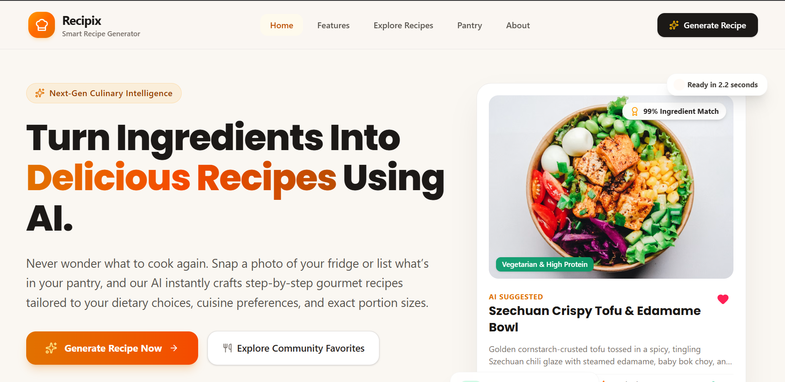
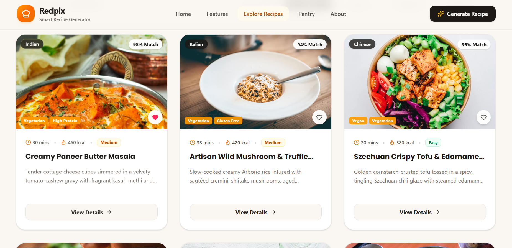
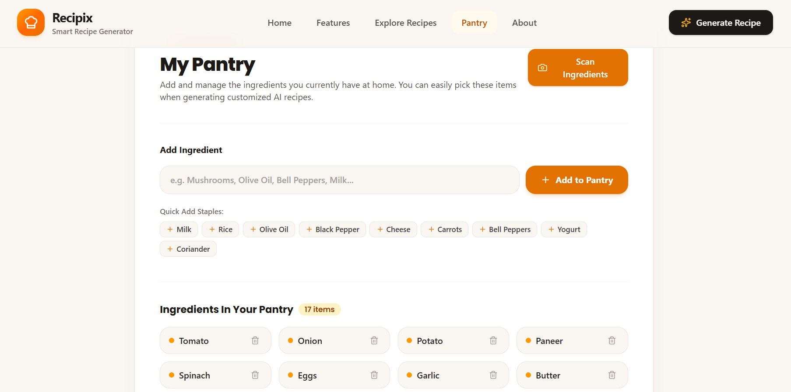
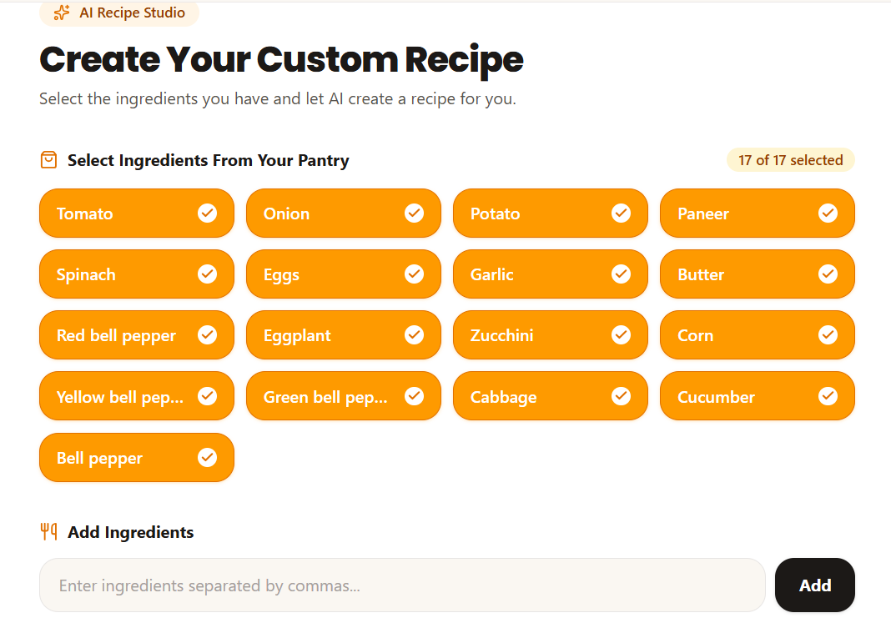
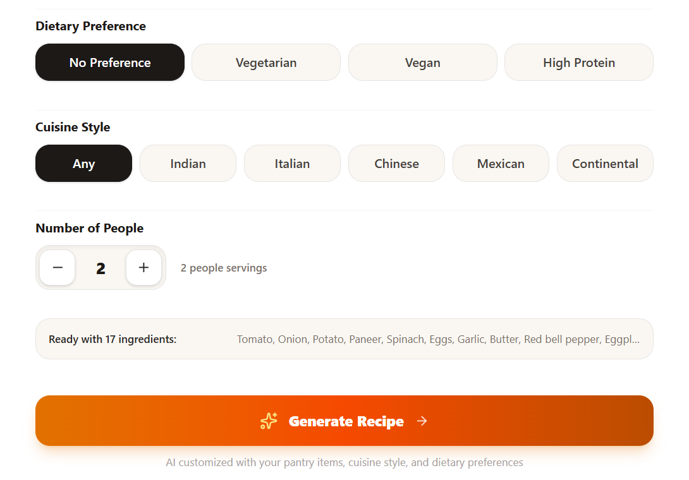
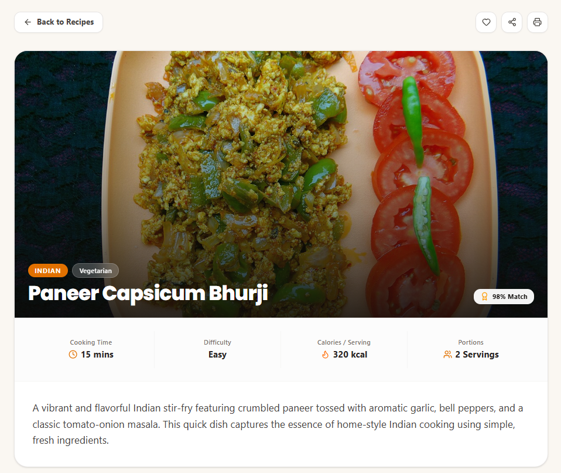
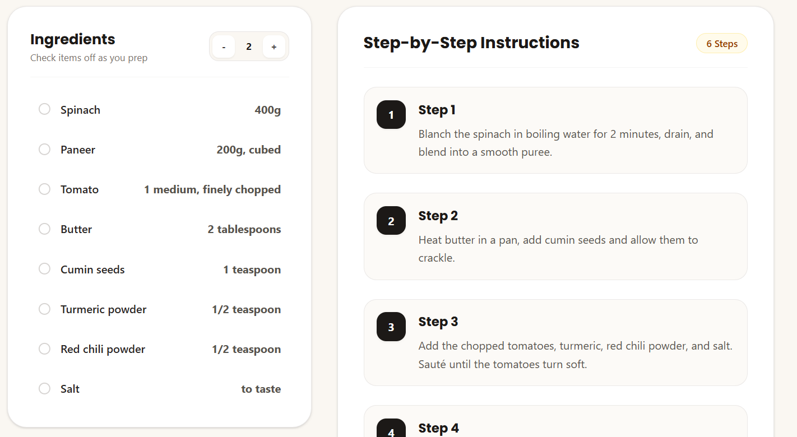
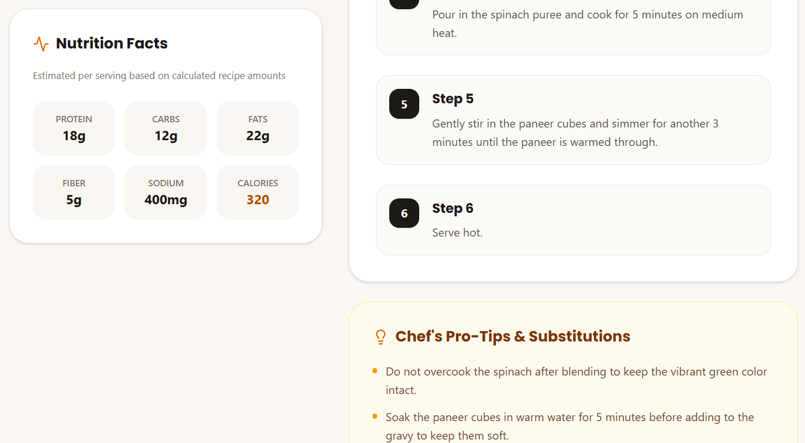

# Recipix 🍳

**Your personal AI-powered recipe generator.**

Recipix helps you discover recipes based on the ingredients you have at home. Generate personalized recipes, explore cooking ideas, and make meal planning easier with the power of AI.

## 📸 Screenshots

### 1. Homepage


### 2. Explore Recipes


### 3. My Pantry


### 4. Ingredient Selection


### 5. Recipe Preferences


### 6. Recipe Overview


### 7. Cooking Instructions


### 8. Nutrition and Cooking Tips


## ✨ Features

- **AI Recipe Generation:** Generate recipes based on your available ingredients.
- **Image Ingredient Scanner:** Upload a food image to identify ingredients using AI.
- **Personalized Recipes:** Customize recipes according to your preferences.
- **Recipe Details:** Explore ingredients, quantities, and cooking instructions.
- **Recipe Discovery:** Browse recipes and find inspiration for your next meal.
- **Responsive Interface:** Enjoy a clean and user-friendly experience.

## 🛠️ Tech Stack

- **Frontend:** React, TypeScript, Vite
- **Backend:** Node.js, Express, Python, Flask
- **AI Integration:** Google Gemini API
- **Styling:** Tailwind CSS

## 📁 Project Structure

```text
recipix/
├── backend/          # Python Flask API
├── public/           # Static assets and images
├── src/
│   ├── components/   # Reusable UI components
│   ├── data/         # Recipe data
│   ├── services/     # API integration
│   └── types/        # TypeScript types
├── server.ts         # Express server
├── package.json      # Node.js dependencies and scripts
├── vite.config.ts    # Vite configuration
└── README.md         # Project documentation
```

## 🎯 Project Goal

Recipix aims to reduce food waste and make everyday cooking easier by helping users turn available ingredients into delicious meal ideas.

---

**Made with ❤️ for food lovers.**
